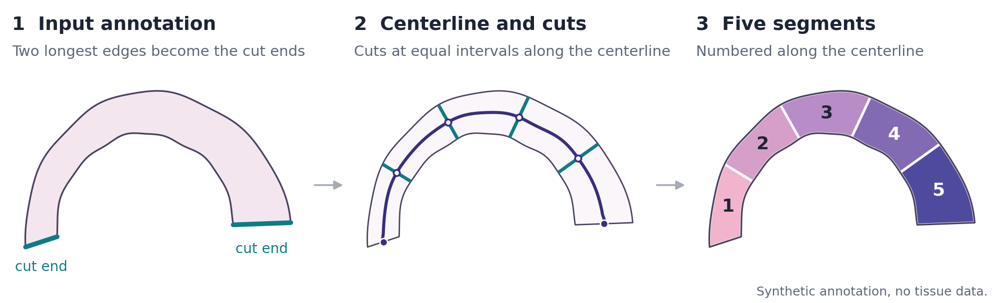

# QuPath Region Subdivision

Subdivide suitable curved polygon annotations in QuPath into five segments at equal intervals along a centerline. Developed for hippocampal CA1 and subiculum, the tool can also subdivide other curved, band-shaped regions that meet the geometry requirements below. Segment areas need not be equal. This geometric workflow operates on existing annotations; it does not detect anatomical boundaries from an image.



The figure uses only synthetic coordinates. Its centerline, cuts and segment geometry come directly from `segment_polygon.py`; segment numbers come from that module's GeoJSON export. No tissue images or research results are included.

## Requirements and installation

Use **Python 3.12** for the pinned environment and **[QuPath 0.6.0](https://github.com/qupath/qupath/releases/tag/v0.6.0)** for the Groovy scripts. Python 3.11 also satisfies the runtime package requirements, but the documented validation uses 3.12. [SciPy 1.17 requires Python 3.11 or newer](https://docs.scipy.org/doc/scipy/release/1.17.0-notes.html); Python 3.10 cannot install these pins.

Download the `qupath-region-subdivision` folder, preserving its structure. Install [Python](https://www.python.org/downloads/) and QuPath for your operating system. Open a terminal in the repository folder.

**Windows PowerShell:**

```powershell
py -3.12 -m venv .venv
.\.venv\Scripts\python.exe -m pip install -r requirements-dev.txt
.\.venv\Scripts\python.exe -m pytest -q
```

**macOS / Linux:**

```bash
python3.12 -m venv .venv
.venv/bin/python -m pip install -r requirements-dev.txt
.venv/bin/python -m pytest -q
```

`requirements.txt` contains NumPy, SciPy 1.17.1 and Shapely for subdivision alone. `requirements-dev.txt` also installs pytest and Matplotlib for tests and reproducible figures. Environments do not need to be activated when invoking their Python executable directly.

## Automatic QuPath workflow

**The annotated band must have two straight boundary edges at its ends.** Each end should be a single edge, longer than the individual edges along the densely sampled sides. The algorithm identifies the two longest boundary edges as the ends; long edges elsewhere can produce an incorrect centerline.

1. Open `qupath/subdivide_auto.groovy` in **Automate → Show script editor**.
2. Set the two full paths at the top, then save your local copy:

   ```groovy
   def PYTHON_EXECUTABLE = 'C:/work/qupath-region-subdivision/.venv/Scripts/python.exe'
   def SUBDIVISION_SCRIPT = 'C:/work/qupath-region-subdivision/segment_polygon.py'
   ```

   These are Windows examples; use forward slashes in Groovy strings. On macOS/Linux, select the downloaded folder's `.venv/bin/python` and `segment_polygon.py` using full paths. Keep the virtual-environment path even if the executable is a symlink. See [local testing](docs/LOCAL_TESTING.md) for platform examples and troubleshooting.
3. Open the matching image and select one or more simple polygon annotations without holes. No polyline is needed.
4. Run the script and inspect the five new segments per original annotation. Inputs and outputs are saved in a fresh `runs/subdivision-*` folder beside `segment_polygon.py`.

Segments use the original annotation name as their prefix, falling back to its classification name, then `Region` if both are absent. For example, a named `CA1` annotation produces `CA1-1` through `CA1-5`. The original PathClass and displayed color are preserved, including for named annotations without a class.

Original annotations and existing files are preserved. Every result is checked before the batch is imported; missing or invalid results import nothing. Repeating a successful run adds another set of annotations in a new run folder. Error messages appear in the script console.

**Numbering does not automatically determine anatomical direction.** Check the starting end and ordering for each annotation before measurements or comparisons. Coordinates are full-resolution image pixels; import into the matching image without resizing or registration.

## Manual-centerline alternative

Select a simple polygon and a polyline running along its middle, keeping the entire line and its endpoints inside the polygon on the same image plane. Run `qupath/subdivide_manual_centerline.groovy`. This workflow requires no Python and preserves the original annotations. Inspect boundaries and numbering; the manual method retains its own ordering convention, including a final reversal.

## Python command line

One input file must contain one valid, nonempty Polygon without holes, represented as a raw geometry, Feature or single-feature FeatureCollection. MultiPolygons and multi-feature inputs are rejected.

**Windows PowerShell:**

```powershell
.\.venv\Scripts\python.exe segment_polygon.py examples/input runs/python-smoke
```

**macOS / Linux:**

```bash
.venv/bin/python segment_polygon.py examples/input runs/python-smoke
```

The synthetic fixture produces `runs/python-smoke/synthetic_band_segments.geojson`. Choose a new output directory if it already exists. General usage is `python segment_polygon.py INPUT_DIRECTORY OUTPUT_DIRECTORY [--segments N]` with the environment's interpreter. CLI names and classification come from the exported GeoJSON properties; original QuPath name/class/color restoration occurs in the automatic Groovy import step.

## Reproduce the figure and examples

Run from the repository folder after installing `requirements-dev.txt`.

**Windows PowerShell:**

```powershell
.\.venv\Scripts\python.exe examples/make_readme_figure.py --input examples/readme/synthetic_band.geojson --output-dir runs/readme-figure
```

**macOS / Linux:**

```bash
.venv/bin/python examples/make_readme_figure.py --input examples/readme/synthetic_band.geojson --output-dir runs/readme-figure
```

This writes `subdivision_example.png` and `synthetic_band_segments.geojson` into `runs/readme-figure`. Existing outputs are refused; use another output folder when rerunning. To update the README image, copy the regenerated PNG to `docs/subdivision_example.png`. The figure preserves algorithm output order and labels segments with numbers only.

`examples/generate_example.py runs/synthetic-example` regenerates the separate curved-band fixture, centerline, segments and a basic diagnostic plot. Invoke it with the same environment's Python. This fixture is used for the Python and QuPath integration tests.

## Method, validation and limitations

The geometric assumptions apply to every region type; automatic endpoint detection does not identify anatomical structures. The automatic method finds the two longest boundary edges, estimates a centerline by averaging resampled boundary sides, smooths it with an endpoint-locked B-spline, and makes perpendicular cuts at equal intervals along the resulting line. Area percentages are segment area divided by original polygon area; areas use squared input-coordinate units.

Count, validity, coverage and overlap are checked before export. Geometry tolerances are `1e-8` times original area. QuPath rounds parsed coordinates, so the integration test permits a separate `1e-4` relative round-trip area tolerance. Batch inputs are preflighted before export; earlier completed output files remain if a later I/O error occurs.

The automatic method requires two straight end edges and may not work reliably for all polygons. Review the resulting subdivisions before analysis. The manual-centerline workflow is available as an alternative.

`python -m pytest -q` runs geometry, file-protection and figure-reproducibility tests. `tests/verify_qupath.groovy` provides optional QuPath 0.6.0/Java 21 checks for both workflows, including automatic naming, classification, colors and failure handling; see [testing instructions](docs/LOCAL_TESTING.md). The automatic workflow has also been tested successfully in desktop QuPath. Cross-platform installation remains dependent on local executable paths and permissions.

## Files

```text
segment_polygon.py                    Geometry and GeoJSON CLI
qupath/subdivide_auto.groovy           QuPath → Python → QuPath
qupath/subdivide_manual_centerline.groovy  QuPath-only alternative
requirements.txt                      Pinned runtime dependencies
requirements-dev.txt                  Tests and figure dependencies
examples/make_readme_figure.py         README figure from production geometry
examples/readme/synthetic_band.geojson Synthetic README input
examples/generate_example.py           Integration fixture generator
examples/input/, examples/output/     Synthetic QuPath fixtures
examples/centerline.geojson            Synthetic manual centerline
tests/                                Python and QuPath checks
docs/LOCAL_TESTING.md                  Desktop testing and troubleshooting
docs/subdivision_example.png          Synthetic README figure
```
